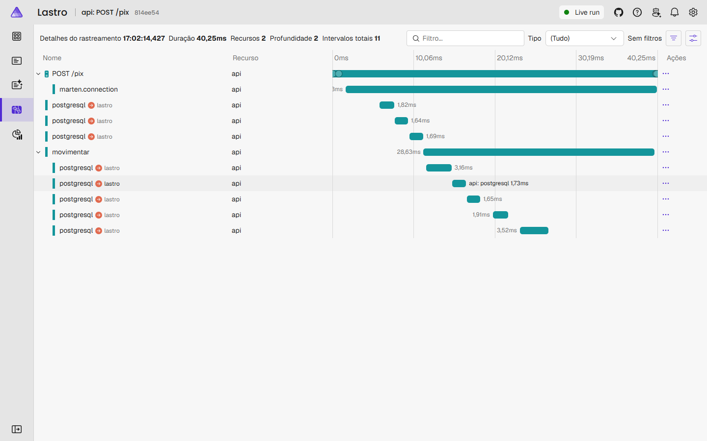
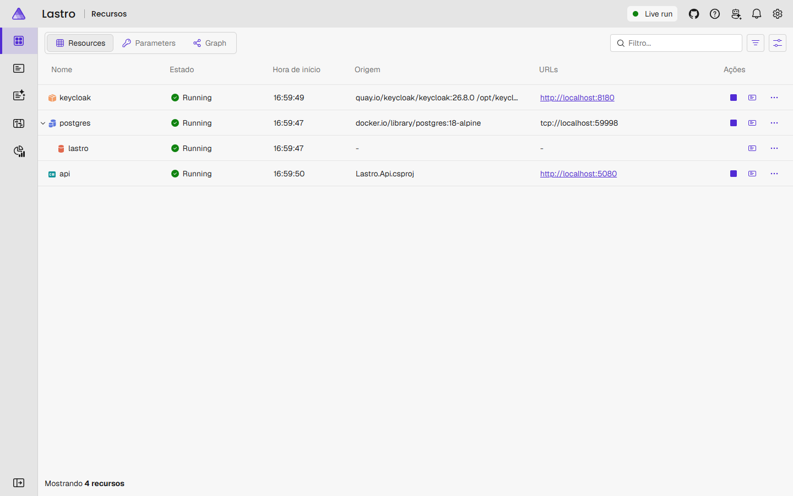
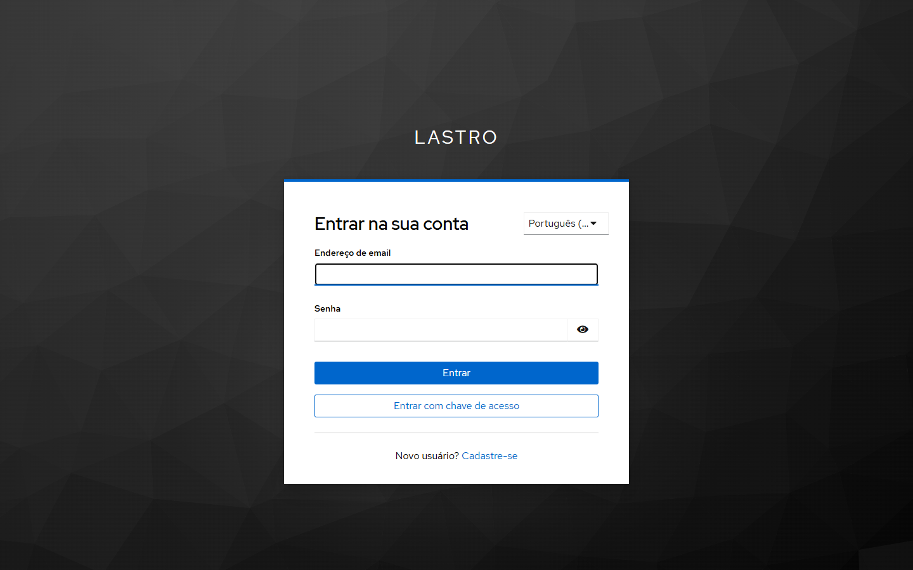
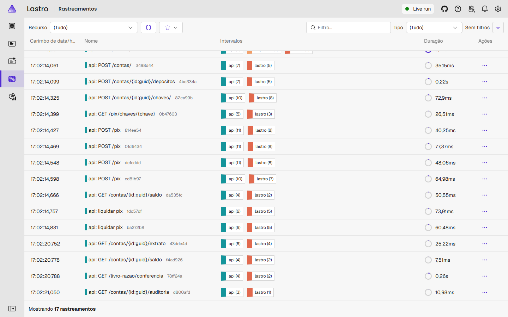
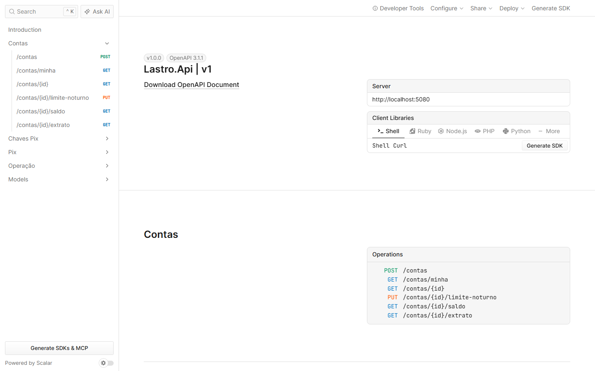

# 🏦 Lastro · Banco digital em .NET

Núcleo de um banco digital em que **o dinheiro nunca some nem duplica**: livro-razão com partidas dobradas,
Pix com chave de idempotência e event sourcing sobre o PostgreSQL. Mil Pix simultâneos saindo da mesma conta
com saldo para cem: passam exatamente cem.

[](https://github.com/nicole21carvalho/lastro-digital-bank-dotnet/actions/workflows/ci.yml)

- **Livro-razão com partidas dobradas**, event sourcing (Marten) e CQRS: a soma de todos os saldos é sempre zero.
- **Pix completo**: chaves no formato do DICT, limite noturno como na regra do Banco Central, Pix para outros
  bancos numa saga com devolução e recebimento por aviso assinado (HMAC).
- **Idempotência e concorrência provadas** no PostgreSQL de verdade, com testes de propriedade (FsCheck).
- **Segurança de banco**: login OAuth 2.0 com passkeys (Keycloak), dono da conta pelo token, limites de uso,
  antifraude e trilha de auditoria.
- **Um comando sobe tudo** com o .NET Aspire, com traces e métricas de cada Pix no painel.



## Como o dinheiro anda

```
POST /pix  { origem: Ana, chave: "bia@exemplo.com", valor: 30,50 }    Idempotency-Key: 7f3c...
  │
  ├─ acha a conta da chave no diretório de chaves (o DICT, simulado)
  ├─ trava as contas de Ana e Bia (SELECT ... FOR UPDATE), sempre na ordem do id
  ├─ a chave de idempotência já foi usada?  sim → devolve a resposta guardada, sem mexer em nada
  ├─ regras do domínio: valor > 0, saldo suficiente, limite noturno, descrição até 140 caracteres
  └─ uma transação só:
       ValorDebitado  Ana  -30,50 ┐ mesmo lançamento,
       ValorCreditado Bia  +30,50 ┘ mesmo valor
       + saldo das duas contas e linhas do extrato (projeções)
       + a resposta, guardada sob a chave de idempotência
```

Quando a chave é de outro banco, o caminho é uma saga, e a soma dos saldos continua zero em cada passo:

```
POST /pix  { chave: "maria@banco-exemplo.example" }  → 202 Accepted, EndToEndId E90000000202610151430...
  │
  ├─ transação 1: Ana -40 → "Pix em trânsito" +40   e o Pix na caixa de saída (outbox), juntos
  │
  └─ trabalhador de liquidação (em segundo plano), pelo SPI do Banco Central:
       liquidado     → "Pix em trânsito" -40 → liquidação +40     (o dinheiro saiu do Lastro)
       recusado      → "Pix em trânsito" -40 → Ana +40            (devolução)
       sem resposta  → consulta pelo EndToEndId e reenvia; nunca devolve sem ter certeza
```

## Ver funcionando

```bash
dotnet run --project src/Lastro.AppHost
```

O .NET Aspire sobe o PostgreSQL, o Keycloak (com o realm `lastro` já importado) e a API, e abre um painel com
logs, traces e métricas de tudo. As senhas do ambiente são geradas na primeira execução e ficam nos
user-secrets da máquina, fora do repositório.

| Painel do Aspire | Login com passkey (Keycloak) |
|---|---|
|  |  |
| **Traces só de trabalho de verdade** | **Documentação da API (OpenAPI + Scalar)** |
|  |  |

## Decisões

**Partidas dobradas: a soma de todos os saldos é sempre zero.** Todo lançamento debita uma conta e credita
outra no mesmo valor. Até um depósito tem duas metades: o dinheiro sai da conta interna de liquidação (que fica
negativa) e entra na do cliente. A rota `GET /livro-razao/conferencia` refaz a conta do livro inteiro a partir
dos eventos, e os testes a chamam depois de cada rodada de concorrência.

**Event sourcing com [Marten](https://martendb.io).** O que fica gravado são os fatos (`ContaAberta`,
`ValorCreditado`, `ValorDebitado`), imutáveis. Saldo e extrato são projeções desses fatos, atualizadas na mesma
transação (CQRS sem atraso). Como nada se perde, `GET /contas/{id}/saldo?em=2026-10-15T09:00:00-03:00` diz o
saldo em qualquer instante do passado. O Marten roda no modo de gravação `Rich`: no modo rápido, que é o
padrão, o número de sequência do evento só nasce dentro do banco, e o extrato perdia a ordem dos lançamentos
(um teste pegou isso).

**Domínio sem dependência.** `Lastro.Dominio` não conhece banco de dados nem web: as regras são funções que
recebem o estado e devolvem os eventos (`Lancamento.Transferir`), e o estado é os eventos aplicados em ordem
(`Conta.Aplicar`). As projeções do Marten chamam essas mesmas funções.

**Concorrência: trava pessimista, em ordem.** Para conta disputada, trava (`SELECT ... FOR UPDATE`) sai melhor
que retentativa otimista: mil transferências na mesma conta viram uma fila, e não novecentas colisões. As contas
são travadas sempre na ordem do id, então A→B e B→A ao mesmo tempo nunca esperam uma pela outra em círculo
(deadlock). Se a trava demorar demais, a resposta é `409 conta-ocupada` com `Retry-After`, não um erro 500.

**Idempotência de verdade.** O app manda uma `Idempotency-Key` por operação. A chave é conferida *depois* da
trava e gravada *na mesma transação* do lançamento: vinte envios simultâneos da mesma chave viram um Pix só.
Repetir a chave devolve a mesma resposta (inclusive uma recusa por falta de saldo), com o cabeçalho
`Idempotent-Replayed`. A mesma chave com outro valor é recusada.

**Limite noturno como na regra do Banco Central.** Das 20h às 6h (horário de Brasília), um cliente pode enviar
até R$ 1.000,00 em Pix *por noite*: a regra é por período, e não por transação. Ele pode mudar o limite, mas um
aumento só vale 24 horas depois. É a defesa contra o golpe em que o criminoso convence a vítima a subir o limite
na hora. Uma redução vale na hora. Como o uso da noite faz parte do estado da conta, que está travada, vinte Pix
de R$ 100 disparados juntos às 21h param exatamente no décimo.

**Chaves Pix no formato do DICT.** CPF só com números, e-mail em minúsculas, celular em `+55DD9XXXXXXXX` e chave
aleatória em UUID, como no diretório do Banco Central. A chave CPF só pode ser o CPF do próprio titular, cada
conta tem até 5 chaves e a mesma chave nunca fica em duas contas: o id do registro é a própria chave, então o
PostgreSQL garante, mesmo com cinco contas disputando a chave ao mesmo tempo. Antes de enviar, `GET
/pix/chaves/{chave}` mostra só o necessário para a pessoa reconhecer quem recebe (`Beatriz M. S.`,
`***.456.789-**`). A chave de outra conta responde igual a uma que não existe, e assim nada vaza.

**Pix para outro banco: uma saga que nunca paga duas vezes.** O débito do cliente e o Pix a enviar são gravados
na mesma transação (padrão outbox): se o processo cair no meio, nada se perde, e o trabalhador de liquidação
continua de onde parou. Cada Pix tem um EndToEndId no formato do Banco Central, e o SPI simulado responde
sempre igual ao mesmo id, então reenviar não paga de novo. A regra que importa está numa função pura do
domínio (`SagaDoPixExterno.Decidir`): "sem resposta" nunca vira devolução, porque o outro banco pode ter
recebido. Primeiro o trabalhador consulta pelo EndToEndId, e só devolve quando é certo que o dinheiro não
chegou. Dois trabalhadores no mesmo Pix? O registro da saga tem controle de versão, e o segundo a gravar perde
a transação inteira, lançamento incluído.

**Pix recebido de outro banco: aviso assinado.** O SPI avisa por `POST /spi/recebimentos`, com HMAC-SHA256 de
`data.corpo` num cabeçalho. A assinatura é comparada em tempo constante, um aviso com mais de 5 minutos é
recusado (ninguém reaproveita um aviso antigo) e o EndToEndId garante crédito único: dez cópias do mesmo aviso
ao mesmo tempo creditam uma vez.

**Conta interna não recebe pedido de fora.** A liquidação e a conta de trânsito podem ficar negativas, então
não conferem saldo. Por isso um Pix saindo delas, ou indo direto para elas, é recusado como se a conta não
existisse. Essa brecha existia na primeira versão: um `POST /pix` com a liquidação como origem seria dinheiro
infinito. Hoje há um teste exatamente para isso.

## Segurança

**Login por token (OAuth 2.0), e a conta é de quem fez login.** A API é um *resource server*: confere a
assinatura (só RS256), o emissor, a audiência (`lastro-api`) e a validade de cada token. O `sub` do token é o
dono da conta. Um login abre uma conta só, e um CPF também, e os dois índices únicos do PostgreSQL garantem
isso mesmo com dois cadastros ao mesmo tempo. Mexer na conta de outra pessoa (Pix, saldo, extrato, chaves,
limite) responde `404`, igual a uma conta que não existe. `403` contaria que ela existe.

**Papéis.** Cliente faz Pix e cuida da própria conta. O depósito em caixa, a conferência do livro-razão e a
auditoria são do papel `operador`. O aviso do SPI não tem login: quem prova a origem é a assinatura HMAC.

**Limites de uso por pessoa.** O Pix e a consulta de chave têm limite por minuto, contado pelo `sub` do
token. Varrer chaves Pix para montar uma lista de nomes é um ataque conhecido ao diretório do Pix, e um robô
com um token roubado não esvazia a conta em segundos. Passou do limite: `429` com `Retry-After`.

**Antifraude como política.** Nas primeiras 24 horas de uma conta, os Pix somam no máximo R$ 500,00
(contas "laranja" são abertas para receber e repassar golpes), e mais de 10 Pix em 10 minutos são barrados
(o padrão de quem esvazia uma conta invadida). As regras são funções puras do domínio. Os valores são
uma política configurável por ambiente.

**Trilha de auditoria sem dado pessoal.** Cada evento guarda nos metadados do Marten quem agiu (o `sub`, o
operador ou o trabalhador de liquidação) e o id do trace da requisição. `GET /contas/{id}/auditoria`, só para
operador, mostra o histórico inteiro com autoria.

**Esquema do banco em um passo só.** Com várias réplicas, só uma (ou um job de migração) cria e altera
tabelas (`Armazenamento:AplicarEsquemaNaSubida`). As outras sobem sem rodar DDL nenhum, porque mudar o esquema
com transações rodando derruba essas transações. Os testes pegaram as duas formas desse erro: uma réplica
mudando funções do Marten enquanto a outra gravava, e uma tabela que o Marten só criaria no primeiro uso.

## Observabilidade

- **OpenTelemetry de ponta a ponta**: requisições, consultas ao PostgreSQL (Npgsql), conexões do Marten e
  spans do próprio banco (`movimentar`, `liquidar pix`), exportados por OTLP para o painel do Aspire ou para
  qualquer coletor.
- **Métricas de negócio sem dado pessoal**: movimentações por tipo e resultado (`feito` ou o código da recusa),
  distribuição dos valores e o desfecho das sagas de Pix para outros bancos. Nenhum valor de transação vai para
  um span, e nenhum id de cliente vai para uma métrica.
- **Ruído é defeito.** O primeiro painel mostrava um trace por segundo: era o trabalhador de liquidação
  espiando a caixa de saída vazia (seriam 86 mil traces por dia) e, a cada 30 segundos, a checagem de saúde do
  orquestrador. As duas consultas agora rodam sem instrumentação, e só o trabalho de verdade vira trace.
- **Saúde em dois níveis**: `/saude` (o processo está de pé) e `/pronto` (e fala com o PostgreSQL).

## Mais decisões

**Dinheiro em centavos inteiros.** `Dinheiro` é um `long` de centavos: R$ 0,10 + R$ 0,20 é exatamente R$ 0,30,
fração de centavo é recusada na entrada e uma soma que estoura o limite falha em vez de virar negativa.

**Dado pessoal fora do event store.** Nome e CPF ficam no cadastro do titular, que pode ser anonimizado
(LGPD). Os eventos, que são para sempre, só levam o id do titular. O CPF passa pela validação dos dígitos, é
único no banco (índice do PostgreSQL) e só aparece mascarado (`***.456.789-**`).

**Erros no padrão RFC 9457.** Toda recusa tem um código estável em `type` (`saldo-insuficiente`,
`conta-nao-encontrada`, `chave-de-idempotencia-reutilizada`...), para o app decidir o que mostrar.

## Testes

```bash
dotnet test     # 130 testes; os de integração sobem um PostgreSQL com Testcontainers (precisa do Docker)
```

- **Propriedades (FsCheck)**: centenas de sequências aleatórias de depósitos e Pix entre quatro clientes. Em
  todas, o dinheiro não é criado nem some, nenhum cliente fica negativo, o livro fecha e repassar o histórico
  reconstrói o mesmo saldo. E, para qualquer sequência de Pix numa noite, o que sai nunca passa do limite.
  Quando uma falha, o FsCheck reduz ao menor exemplo que quebra.
- **Relógio nas mãos do teste**: com o `FakeTimeProvider`, os testes do limite noturno "são 21h" e pulam 24
  horas para ver o aumento passar a valer.
- **Concorrência, no PostgreSQL de verdade**: mil Pix simultâneos com saldo para cem (passam exatamente cem e
  novecentos são recusados), 400 Pix cruzados entre duas contas (nenhum trava) e 250 depósitos em paralelo.
- **Idempotência**: repetição, recusa lembrada, chave reaproveitada e vinte envios simultâneos.
- **Saga do Pix para outro banco**: liquidado, recusado (o dinheiro volta e o extrato mostra as duas linhas) e
  sem resposta duas vezes antes de liquidar (três tentativas, um pagamento só).
- **Ataques ao aviso de Pix recebido**: assinatura errada, corpo alterado depois de assinado, aviso antigo
  reenviado e dez cópias simultâneas.
- **Segurança**: sem token, token de outro emissor, de outra audiência, vencido ou com a assinatura
  adulterada; uma pessoa tentando tudo na conta de outra; cliente tentando o que é do operador; Pix saindo da
  conta interna do banco; limites de uso; antifraude; e a autoria de cada evento na auditoria. Os tokens dos
  testes são assinados na hora, com uma chave RSA criada para a rodada.

Além dos testes, o fluxo inteiro foi conferido no ambiente do Aspire com tokens de verdade do Keycloak: abrir
contas, depositar, Pix por chave, Pix para outro banco (liquidado e devolvido), recusa por saldo, `404` na conta
de outra pessoa, extrato, conferência do livro e auditoria.

**No CI** (GitHub Actions, com as actions fixadas por SHA): formatação (`dotnet format`), build com os
analisadores e aviso tratado como erro, os testes com Testcontainers, **CodeQL** (análise de segurança do
código C#), **osv-scanner** nos `packages.lock.json` e o build da imagem Docker. O Dependabot atualiza
pacotes, actions e imagens toda semana.

Os bancos, as pessoas e os ISPBs do Banco Central simulado são fictícios (domínios `.example`).

## Rodando sem o Aspire

```bash
docker build -t lastro-api .        # imagem "chiseled": sem shell, sem gerenciador de pacotes, usuário sem privilégios
docker run -p 8080:8080 \
  -e ConnectionStrings__Lastro="Host=...;Database=lastro;Username=...;Password=..." \
  -e Autenticacao__Emissor="https://seu-keycloak/realms/lastro" \
  -e Spi__Segredo="$(openssl rand -hex 32)" \
  lastro-api
```

O realm do Keycloak (app com PKCE, audiência `lastro-api`, papel `operador` e passkeys) está em
[`infra/keycloak/lastro-realm.json`](infra/keycloak/lastro-realm.json). Com várias réplicas, deixe
`Armazenamento__AplicarEsquemaNaSubida=false` em todas menos uma.

## Stack

.NET 10 · C# 14 · ASP.NET Core (minimal APIs, validação nativa, OpenAPI, rate limiting) · Marten 9 (event store
e documentos) · PostgreSQL 18 · Keycloak 26 (OAuth 2.0, passkeys) · .NET Aspire 13 · OpenTelemetry · xUnit v3 ·
FsCheck · Testcontainers · Docker (chiseled) · GitHub Actions · CodeQL
